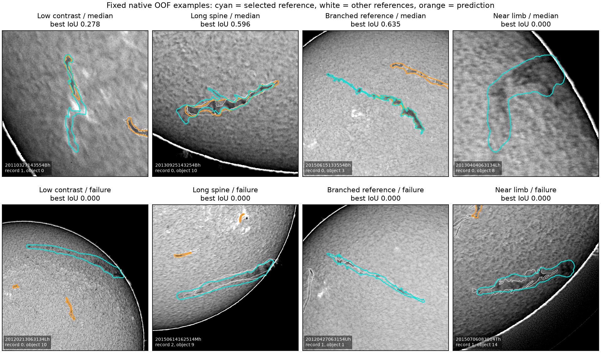

# Annotation-derived hard cases

See [the complete definitions and reproduction instructions](../../docs/hard-cases.md).

Predictions use the complete four-network group-confined native study at cutoff0.30.
Image and annotation source: official MAGFiLO/GONG competition training data;
preserve attribution and competition data terms.
