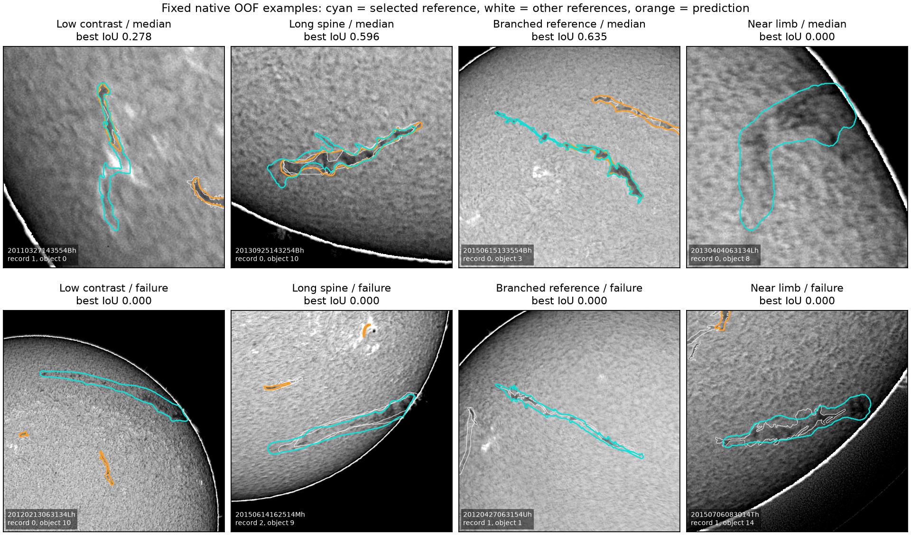

# Annotation-derived hard cases

This read uses the report's four-network group-confined native masks at cutoff
0.30 on all 707 labelled observations, 1,154 records and 8,199 annotation
objects. Native pooled PQ is 0.4575560813. Every queried annotation group is
excluded from all neural ancestors and utility fitting. These validation masks
differ from the contained deployment models' predictions.

| Category | Objects / images | Detected, best IoU > 0.5 | Mean best IoU |
|---|---:|---:|---:|
| Lowest contrast tenth | 820 / 328 | 0.320 [0.276, 0.359] | 0.288 [0.248, 0.321] |
| Longest annotated spine tenth | 820 / 356 | 0.633 [0.592, 0.679] | 0.532 [0.511, 0.556] |
| Branched reference masks | 477 / 295 | 0.681 [0.644, 0.730] | 0.558 [0.537, 0.587] |
| Near the limb | 455 / 255 | 0.354 [0.254, 0.471] | 0.273 [0.197, 0.360] |

Intervals are 90% whole-annotation-group bootstrap intervals over 4,000 draws,
conditional on fixed predictions, selected recipes and observed groups.
Objects repeat physical structures across annotation records; categories
overlap. Retraining, search and unknown test annotation styles are outside
these intervals. These rates measure agreement with supplied annotations.
Physical completeness and magnetic chirality remain unmeasured.

Cyan marks the selected reference, white the other annotation records, and
orange the model predictions. The upper row is closest to the category's
median best IoU; the lower row has the smallest best IoU. Ties prefer larger
reference area, then stable image, record and object identifiers. Each choice
prefers an image unused by earlier panels. These eight examples illustrate
geometry and errors; they do not estimate prevalence.

## Definitions

Contrast is the mean flattened-image intensity in a three-pixel outside ring
minus the mean inside the reference polygon. The lowest tenth has contrast at
most 0.06142. The longest-spine tenth has annotated polyline length at least
285.23 native pixels. Both thresholds use all 8,199 reference objects.

The branched set has at least ten connected clusters of skeleton junction
pixels, area at least the reference median of 1,228 pixels, one connected
component and no holes. Junction pixels have more than two eight-connected
skeleton neighbours. Near-limb references have centroid distance from the
fitted disk centre at least 0.85 times its radius. These are image and geometry
proxies; the dataset supplies no physical-barb labels for this analysis.

## Reproduce the read

Use the pinned environment, official competition training data and the flat
image/disk cache described in the main README. Set `FILAMENT_DATA` to the
official data and `FILAMENT_CACHE` to that cache. From the repository, run
`uv run python scripts/read_committee_hard_cases.py --selection
analysis/hard_cases/predictions_group_tau0.30.csv --expected-pq
0.45755608127795366 --cache <cache> --out <new-analysis-folder> --protocol
"Group-confined four-network CPU masks at cutoff0.30" --source-note
"All neural ancestors and utility fits exclude the queried annotation group;
fixed fitted models and selected recipes;deployment masks differ."`.

Adding `--object-features analysis/hard_cases/objects.csv` reuses the fixed
annotation/image features. It verifies the complete object inventory, group,
area and spine length, and recomputes every overlap against the supplied
native predictions. Eight direct-image controls reproduce all cached features
and native counts exactly. Omitting the option recomputes geometry and contrast
from the official data. Neither route fits a model or performs neural inference.

The reader checks the complete native PQ control, writes per-object
measurements, recreates group intervals and selects the panel by the stated
rules. It reads no test image. Saved measurements and exact example identifiers
are in [`result.json`](../analysis/hard_cases/result.json) and
[`objects.csv`](../analysis/hard_cases/objects.csv).

Images and annotations come from official MAGFiLO/GONG competition training
data. Preserve their attribution and competition data terms when reusing them.
