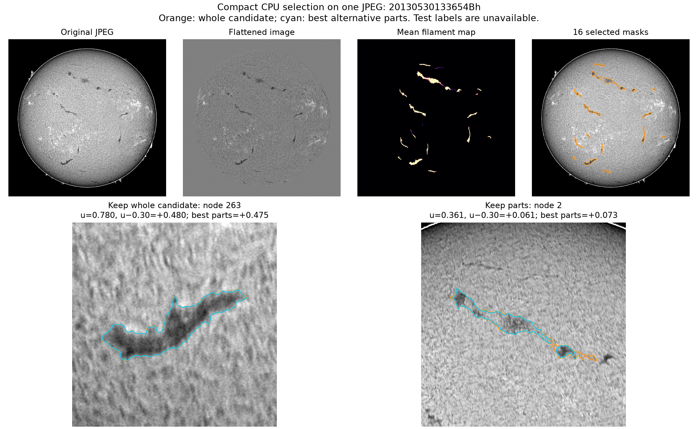

# One prediction, explained

This example follows the compact CPU model from one official GONG H-alpha JPEG
to its 16 selected masks. It uses image `20130530133654Bh`, chosen by the largest
number of masks in the retained CPU submission, with a lexical image tie-break.
Its 16 masks reproduce the scored CPU cutoff-0.30 reference exactly. Test labels
are unavailable; the example explains the calculation without measuring its
physical correctness.

The top row shows the original JPEG, the flattened image, the mean dense map
and the final masks. Flattening suppresses the disk's broad brightness pattern.
Two segmentation networks supply the map; two instance detectors supply extra
evidence. The candidate tree has 302 nodes in this image. Each node has 53
image, tree and detector features.

The learned utility is `u = h × m`. Here `h` estimates the frequency of a strict
IoU-above-0.5 match across independent annotation records. The conditional term
`m` estimates the largest matching IoU within a record when a match exists.
These are learned estimates, with the validation limits described in DESIGN.
The selector maximizes the sum of `u − 0.30` over a disjoint set of nodes.
Its cutoff is different from the map thresholds used to construct candidates.

| Decision | Utility h × m | Whole candidate gain | Best parts gain |
|---|---:|---:|---:|
| Keep node 263 whole | 0.963390 × 0.809268 = 0.779641 | 0.479641 | 0.474676 |
| Split node 2 into nodes 81 and 267 | 0.607390 × 0.593867 = 0.360709 | 0.060709 | 0.072688 |

Orange outlines the whole candidate; cyan outlines the best alternative parts.
For node 263, keeping the whole shape beats its best descendant. For node 2,
the two parts score more together than the whole. Their individual utilities
are 0.338339 and 0.334349. The larger shape comes from map threshold 0.05;
node 263 comes from threshold 0.60. Those thresholds do not replace the learned
utility cutoff of 0.30.

An independent integer program reaches the same total additive value,
4.2412011454. Brute-force enumeration also agrees on 25 small subtrees. The
integer program chooses a different equal-value node in one tie. The deployed
tree pass uses its fixed tie rule. These checks establish the optimum of the
learned additive objective; they do not establish an optimum of host PQ.

## Reproduce

From the repository's pinned environment, run `uv run python
scripts/explain_one_image.py --data <official-data-root> --out <new-folder>`.
It loads the contained weights, performs CPU inference on one JPEG, checks all
native masks against `release/submission_cpu_tau0.30.csv` and writes the figure
and decision values. It needs no precomputed neural cache. The recorded live
replay used four PyTorch threads. An optional `--cache` can reuse the separately
checked complete CPU trace.

The saved [values](../analysis/selection_example/result.json) include all chosen
node identifiers, the two decisions and the independent optimum checks. No new
model fitting or test-label access is involved. Images come from the official
MAGFiLO/GONG competition data; retain its attribution and data terms.
